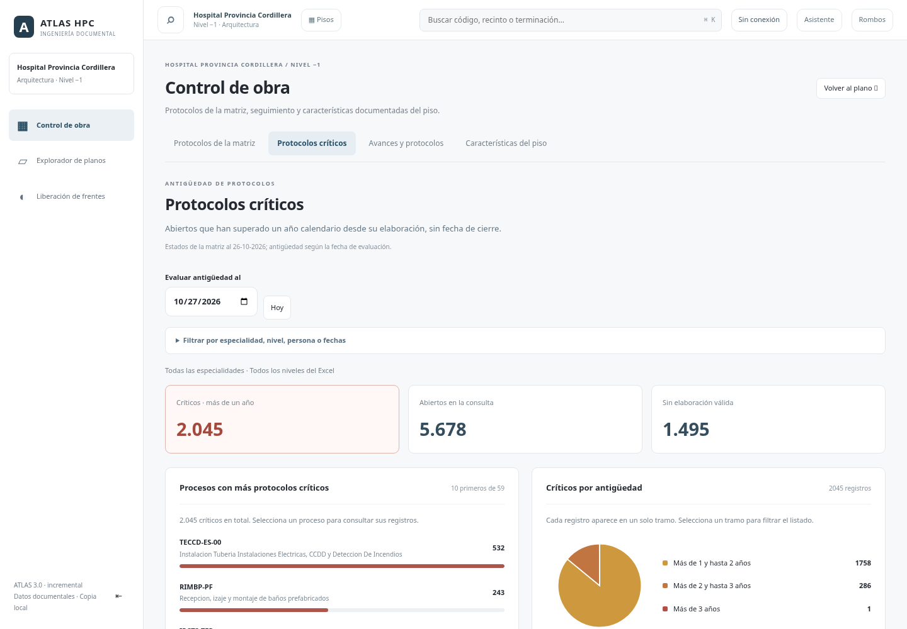

# Fechas y criticidad de protocolos

## Consulta de estados y fechas

En **Control de obra → Protocolos de la matriz**:

- Abierto, Cerrado, Cerrado por autocontrol y Nulo conservan su significado y valor original.
- **Pendiente de cierre (abiertos)** es un alias de consulta de ABIERTO. La matriz recibida no contiene un estado PENDIENTE separado; no se inventa ni se modifica una clasificación de la fuente.
- **Cerrados (incluye autocontrol)** agrupa CERRADO y CERRADO POR AUTOCONTROL. No incorpora NULO por el hecho de tener una marca en la columna CERRADO.
- Fechas: elaboración o cierre, con Desde/Hasta inclusivos. Un registro sin fecha válida no entra en un intervalo de esa fecha. Límites invertidos muestran error y no resultados antiguos.
- Solo críticos aplica la regla siguiente y muestra su fecha de evaluación. El criterio se conserva al cerrar/reabrir o recargar. Cambiar el criterio no escribe en Excel.

## Regla de criticidad

Un registro es crítico cuando su estado es abierto, su elaboración tiene una fecha válida, no tiene un dato de cierre y la fecha evaluada es **estrictamente posterior al primer aniversario calendario**. Cumplir exactamente un año aún no es «más de un año».

El aniversario del 29 de febrero en un año no bisiesto se toma el 28 de febrero; ese día exacto no es crítico, el 1 de marzo sí. Las fechas se comparan como días, sin convertirlas en horas transcurridas ni usar un umbral fijo de 365 días. Hoy se obtiene con la zona America/Santiago.

Cerrados, cerrados por autocontrol y nulos quedan excluidos aunque falte su fecha de cierre. Una fila abierta con dato de cierre en conflicto no se marca automáticamente como crítica. Los abiertos sin elaboración válida aparecen aparte y no reciben fechas supuestas. Los valores raw de origen, incluyendo espacios, permanecen intactos.

La fecha elegida modifica la antigüedad, no reconstruye un historial de estados. **Los estados siguen siendo los registrados en el Excel al corte 26-10-2026.** Hoy se actualiza al reabrir/retomar la vista; elegir una fecha personalizada la conserva para reproducir el análisis.

## Gráfico y consulta de registros

**Control de obra → Protocolos críticos** contiene:

1. Fecha de evaluación y botón Hoy.
2. Filtros desplegables por especialidad, nivel del Excel, recibe, intervalo de elaboración y nombre/código de proceso.
3. Indicadores de críticos, abiertos de la consulta y abiertos sin elaboración válida.
4. Barras con los diez procesos con más registros críticos. El encabezado informa que se muestran los diez primeros; el total global permanece visible.
5. Torta con categorías excluyentes: más de 1 y hasta 2 años; más de 2 y hasta 3; más de 3. La selección del tramo se refleja visualmente y filtra la lista.
6. Tabla de 25 filas por página, ordenada de más antiguos a más recientes. Un proceso o folio abre su consulta documental con los mismos filtros y fecha; seleccionar un folio sitúa su página y ficha exactas.

Los conteos son de **filas documentales**, conservando combinaciones repetidas de código/folio. No son cantidades de producción ni una aprobación técnica.

[Vista móvil](images/critical-protocols-mobile.png)

## Recuento de referencia

Con la matriz recibida, sin filtros y evaluando al 27-10-2026:

| Conjunto | Registros |
|---|---:|
| Abiertos en la matriz | 5.678 |
| Críticos | 2.045 |
| Abiertos sin elaboración válida | 1.495 |
| Críticos de más de 1 y hasta 2 años | 1.758 |
| Críticos de más de 2 y hasta 3 años | 286 |
| Críticos de más de 3 años | 1 |

Se verificaron estos totales contra una lectura independiente del XML del Excel. Entre las fechas ausentes se incluyen 38 valores de elaboración compuestos por espacios: no deben compararse lexicográficamente como si fueran fechas antiguas.

## Implementación y offline

- `protocol-values.mjs` conserva las funciones comunes de normalización y fecha Excel sin crear dependencias circulares.
- `protocol-aging.mjs` valida días, calcula aniversarios y tramos, filtra intervalos y analiza abiertos con procedencia.
- `protocol-critical.mjs` presenta gráficos, controles y listado, y enlaza la selección a la consulta existente.
- `protocol-catalog.mjs` añade filtros y badges sin cambiar los valores fuente; `workspace.mjs` integra la vista dentro de Control de obra.
- `scripts/import-protocol-matrix.py` genera `protocols/open-aging.json`, con solo los campos necesarios de los abiertos. No se cargan los veinte mil detalles ni el Excel para dibujar el gráfico. Se valida hash, esquema, código y fila contra el catálogo.

El índice se carga al abrir el análisis, se conserva al consultarlo y pertenece al paquete offline de plano y fichas. Los módulos son parte del núcleo offline. No se modifica el Excel original, las bases SQLite, las geometrías o las 154 colecciones completas de detalle.

## Pruebas

`critical-protocol-test.mjs` verifica aniversario exacto, día siguiente, año bisiesto, datos ausentes/espacios, cierres y conflictos excluidos, rangos inclusivos/invertidos, día en Chile, igualdad del índice con los abiertos originales, totales de referencia, agrupaciones, esquema/versión y manifiesto offline. Forma parte del build de Render.

`critical-protocol-browser-test.mjs` usa servidor protegido y Chromium a 1440/390 px: gráfico global sin descargar los detalles completos, tramos seleccionados, filtros de consulta, salto a fila original, alias Pendiente, fechas de elaboración y cierre, rangos inválidos, criterio persistido, Hoy/fecha personalizada, reintento y recarga real con red deshabilitada. Los recuentos de referencia son de la fuente recibida y no se insertan datos de demostración en el programa.
