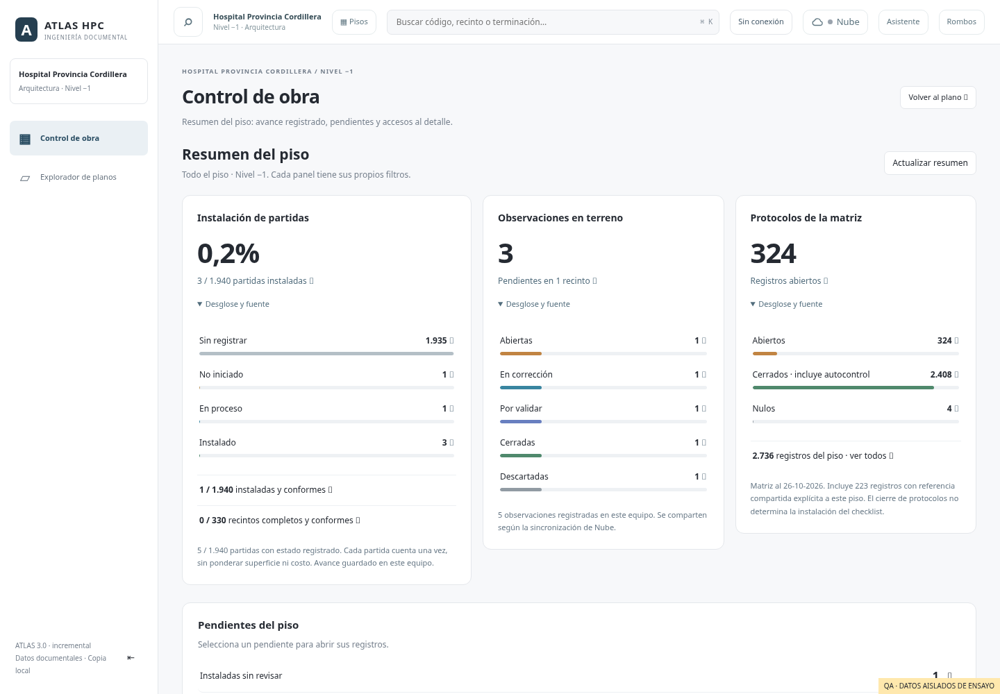

# Resumen del piso en Control de obra

Al entrar a Control de obra se muestra el resumen del piso activo. Debajo siguen los tres paneles de detalle: Observaciones en terreno, Avance por recinto y Protocolos de la matriz. El botón «Resumen del piso» permite regresar desde cualquiera de ellos.

En móvil, cada tarjeta muestra su indicador principal y permite ampliar «Desglose y fuente»; en escritorio el desglose se abre inicialmente. Los pendientes conservan accesos directos debajo de las tarjetas.

## Indicadores y accesos

| Indicador | Base | Destino al pulsar |
|---|---|---|
| Partidas instaladas | Partidas aplicables con definición PMA de los recintos únicos del piso | Detalle de partidas instaladas |
| Estado de instalación | Sin registrar, no iniciado, en proceso o instalado | Detalle del estado seleccionado |
| Instaladas y conformes / recintos completos | Reglas del checklist existente | Partidas conformes o recintos completos |
| Instaladas sin revisar / partidas con observaciones | Condición del checklist | Detalle de las partidas correspondientes |
| Observaciones pendientes, vencidas o por validar | Observaciones guardadas para ese piso | Inventario con el filtro indicado, restableciendo filtros de una consulta anterior |
| Protocolos abiertos, cerrados o nulos | Facetas por nivel y estado de la matriz REV1 | Selector de protocolos del piso con ese estado y sin búsqueda/especialidad anterior |

El resumen consulta todo el piso. Cada panel mantiene sus propios filtros. El checklist conserva sus denominadores y cuenta cada partida una vez, sin ponderar superficie ni costo. «En proceso» permanece como estado; no se le asigna un porcentaje inventado. «Sin registrar» se distingue de «No iniciado».

Las fuentes cambiadas quedan pendientes de cotejo. Los recintos sin correspondencia PMA y las partidas sin definición se informan expresamente. Cuando no existe base aplicable se muestra «Sin base».

Las observaciones por validar conservan el estado almacenado `Corregida`. Una corregida deja de contar como vencida según las reglas existentes. El cierre de una observación o de un protocolo no modifica el checklist.

Los protocolos incluyen las referencias compartidas explícitas al piso y mantienen la fecha de corte del Excel. No se deducen niveles intermedios de una referencia como N01-N09. Su acceso abre los tipos del estado elegido; la consulta de folios sigue en el panel de matriz.

## Guardado, carga y disponibilidad

- Solo se leen las bases y fuentes existentes. No hay cambios de SQL, permisos ni configuración de cuentas.
- El avance sigue guardado en el dispositivo. Las observaciones reflejan la copia disponible en el equipo y la sincronización de Nube existente.
- Los cambios guardados actualizan el resumen visible. También se puede pulsar «Actualizar resumen» y se actualiza al regresar a la ventana.
- Las tres fuentes cargan de manera independiente. Si una falla, su tarjeta indica que no se pudo leer y ofrece reintentar; los demás indicadores siguen disponibles. Un error de lectura nunca se representa como cero registros.
- Las respuestas tardías se descartan al actualizar el resumen o cambiar de panel. Las consultas de detalle existentes conservan edición, evidencia e historial.
- Los módulos están incluidos en el núcleo sin conexión. Las fuentes del piso deben estar disponibles en la caché; se mantienen los controles de descarga existentes.

## Validación

- `node floor-overview-test.mjs`: fuentes reales en cuatro pisos; códigos únicos, aislamiento de registros, misma base aplicable, fuentes cambiadas/sin PMA, vencimientos y niveles compuestos explícitos.
- `PLAYWRIGHT_MODULE=/workspace/atlas-browser-tools/node_modules/playwright-core/index.mjs node floor-overview-browser-test.mjs`: cuatro pisos en 390 y 1440 px; resumen, accesos con filtros, teclado, edición y recálculo, apertura del recinto en plano, filtros anteriores, errores recuperables, cambios mientras se ve el resumen, respuestas tardías y recarga sin red con el service worker real.
- Regresión de los gráficos de avance y de observaciones con fotos/comentarios; ver `progress-analysis-browser-test.mjs` y `observaciones-flow-browser-test.mjs`.
- Comando de build de Render y comprobación del paquete sin conexión.

Capturas de ensayos aislados; sus registros no se incorporan a las fuentes ni a producción:

[Resumen del piso en móvil, datos QA](images/floor-overview-mobile.png)
