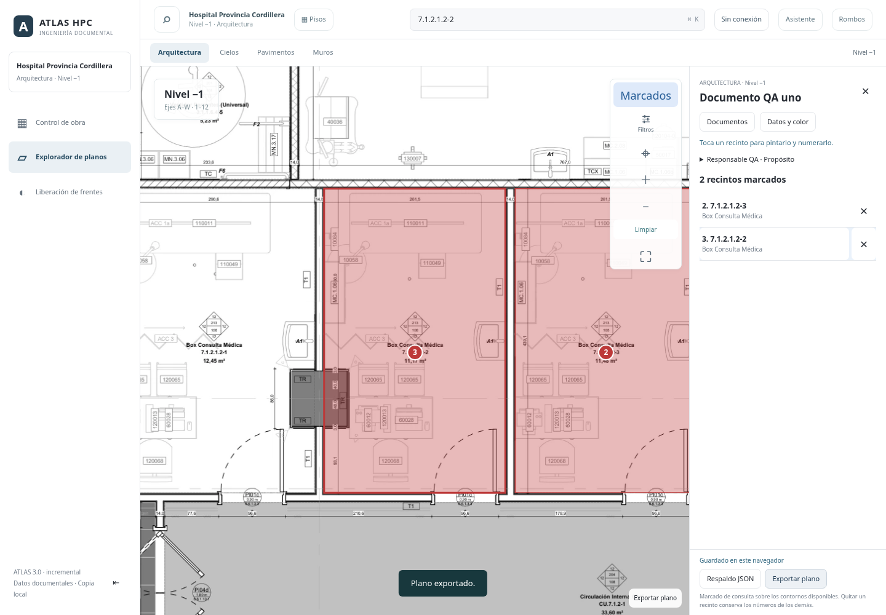
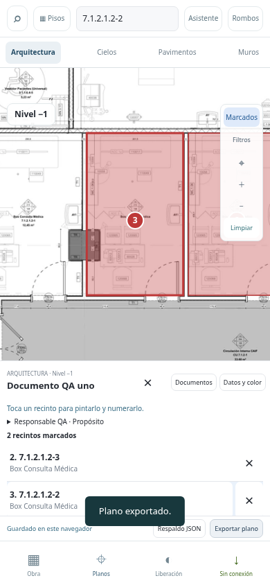

# Documentos de marcado de Arquitectura

> **Proyectos (27-10-2026).** El botón se llama ahora **Proyectos** y los documentos admiten:
> - **Leyenda de estados**, ordenada de menor a mayor avance (por ejemplo, Pendiente → En ejecución → Terminado), en vez de un solo color.
> - **Cortes con fecha**, para comparar el avance entre períodos.
>
> El uso de un color descrito abajo sigue igual (plantilla «Un color»). Ver «Proyectos: estados, cortes y comparación» al final.

## Uso

1. Abrir el piso y Arquitectura; pulsar **Proyectos → Nuevo proyecto**.
2. Completar nombre del documento, quién lo realizó y para qué es el plano. Los tres campos son obligatorios, incluso después de quitar espacios. Elegir color.
3. Tocar el interior de un recinto. Se pinta sobre el contorno existente y aparece en la lista como «1. código», con su nombre original. Otro toque sobre el mismo recinto no lo duplica ni lo borra.
4. La lista queda a la derecha en escritorio y en una franja debajo del plano en móvil. Pulsar una fila acerca ese recinto; × quita su marcado. Los números de los demás no cambian y los números retirados no se reutilizan.
5. **Datos y color** edita los datos del documento; **Documentos** permite abrir otro o crear uno nuevo. Cerrar el documento retira los colores de esa vista, pero conserva el documento guardado.
6. **Exportar plano** descarga PDF con colores, números, nombre/autor/propósito, fechas y relación numerada de recintos y láminas. **Respaldo JSON** y **Restaurar respaldo** permiten trasladar el documento a otro navegador. También se puede respaldar el conjunto del piso.

La búsqueda global acerca un resultado único, pero no lo marca: hay que tocar el plano. Los filtros de terminaciones y la navegación normal se recuperan al salir del marcado. Cambiar de especialidad o módulo cierra el documento de marcado activo.

## Persistencia y alcance

Guardado automático por transacción en IndexedDB `atlas-marking-documents`, tabla `documents`. Cada documento tiene UUID, piso, especialidad `architecture`, metadatos obligatorios, color, fechas, versión, próximo número y referencias de recintos. Cada referencia conserva id, código, nombre, lámina, revisión y número. No se modifican terminaciones, avances, SQLite, PMA, rombos ni geometrías.

Las escrituras del mismo documento se serializan y comprueban la versión guardada. Un conflicto entre pestañas no sobrescribe el otro cambio; muestra el error y requiere reabrir el documento. No se anuncia guardado hasta que la transacción se completa. La importación es atómica, idempotente para respaldos idénticos y rechaza conflictos sin sustituir documentos. Las identidades duplicadas, números repetidos, metadatos incompletos y respaldos inválidos se rechazan.

El guardado es local a este origen y navegador. **No existe sincronización multiusuario ni copia automática en el servidor**. El respaldo JSON es necesario para llevarlo a otro equipo. Los módulos forman parte del núcleo offline; se probó reapertura de documentos después de recargar sin red. La exportación necesita la imagen del plano y el generador PDF disponibles (red o paquete offline descargado).

Los colores son anotaciones del usuario, no una certificación de obra ni nuevos límites técnicos. Se usan los contornos disponibles y los códigos existentes. Si un recinto deja de estar disponible en el plano, se conserva en la lista con aviso y sin fabricar una ubicación. La exportación utiliza una instantánea del documento al iniciar la descarga.

## Verificación

- `node marking-test.mjs`: campos obligatorios, validación, referencias inmutables, repetición de clic y numeración después de eliminar/agregar.
- `PLAYWRIGHT_MODULE=/workspace/atlas-browser-tools/node_modules/playwright-core/index.mjs node marking-browser-test.mjs`: Chromium 1440×1000 y 390×844, creación, clics reales, búsqueda sin marcado automático, separación geométrica entre lista/plano, color, eliminación, numeración, documentos independientes, PDF comprobado con `pdftotext`, respaldo, recarga, conflicto entre versiones, restauración en otro navegador, separación de pisos y reapertura offline. Requiere Chromium y `pdftotext`.
- Regresión de selección/colores, navegación por pisos, gestos, recursos protegidos y manifiesto offline.

Capturas con datos de prueba, sin estados reales de obra:

Publicación mediante PR a `main`, revisión y despliegue manual de Render. No cambiar la rama del servicio.

## Proyectos: estados, cortes y comparación

Un proyecto parte de cualquiera de los cuatro pisos y sirve, por ejemplo, para levantar los pisos vinílicos instalados y luego medir su avance mes a mes.

1. **Leyenda.** En **Nuevo proyecto** o **Datos y leyenda** se eligen los estados, ordenados de menor a mayor avance. Hay dos plantillas, «Un color» y «Pendiente · En ejecución · Terminado», y se pueden agregar estados (hasta 8), renombrarlos, cambiar su color y reordenarlos. Si se quita un estado, sus recintos pasan al primero.
2. **Pintar.** Con varios estados aparece el pincel «Pintar con»: se elige un estado y se tocan los recintos.
   - Tocar un recinto con otro estado lo cambia y conserva su número.
   - Tocarlo con el mismo estado no hace nada.
   - El panel muestra cuántos recintos y m² (superficie de la ficha) hay en cada estado.
3. **Cortes.** «Guardar corte» guarda los estados de ese momento con nombre (por ejemplo, «Cierre octubre 2026»), fecha y autor. Los cortes no cambian con el avance posterior y se pueden eliminar con doble confirmación.
4. **Comparar.** «Comparar» en un corte lo enfrenta con el siguiente corte o con el estado actual; ambos extremos se pueden cambiar.
   - El plano pinta los recintos que **avanzaron** (verde), siguieron **sin cambio** (gris) o **retrocedieron** (rojo), según el orden de la leyenda. Un recinto nuevo cuenta como avance y uno quitado como retroceso.
   - El panel muestra los totales, una tabla por estado con recintos y m² en cada corte, y la lista de recintos con cambios.
   - **Ver lado a lado** muestra los dos cortes uno junto al otro sobre la vista general del plano, encuadrada en los recintos del proyecto.
   - **Exportar plano** respeta la vista: estados o cambios, con la leyenda correspondiente en el PDF.

**Datos:**
- Los documentos del esquema 1 (un color) siguen siendo válidos. Al abrirlos se tratan como un proyecto con un estado «Marcado» y se guardan en el esquema 2 con el siguiente cambio.
- Se usan la misma base IndexedDB, el mismo respaldo JSON y el mismo control de versiones descritos arriba.
- `proyectos-test.mjs`, incluida en el build de Render, prueba la leyenda, el pintado por estado, los cortes, la comparación y la compatibilidad con los marcados de un color.
