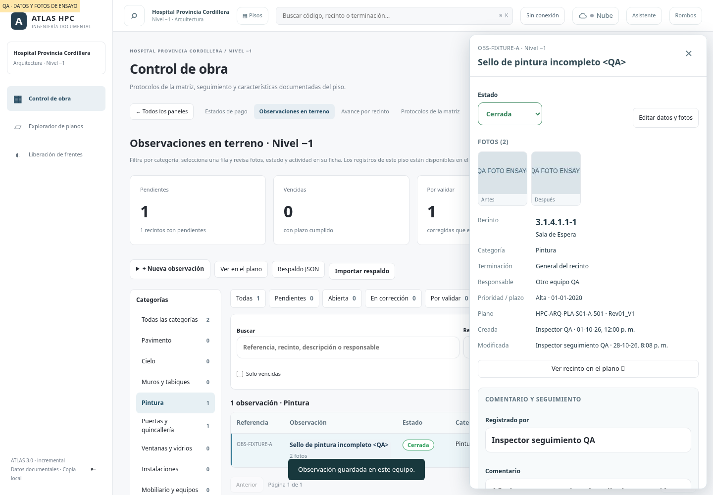
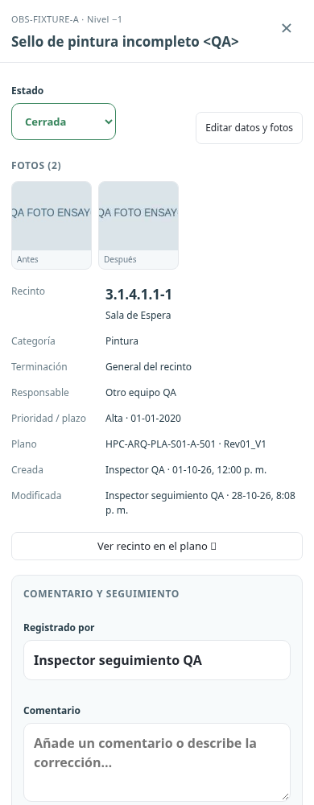

# Observaciones: categorías, lista y ficha de seguimiento

La referencia de interacción es la captura de FunBIM suministrada por el usuario: una observación se consulta antes de editarla y reúne fotos, datos y conversación. Este cambio adapta ese flujo a los registros existentes de Atlas.

## Inventario

Control de obra → Observaciones en terreno abre categorías con cantidades, filtros rápidos por estado y una lista por filas. Las categorías conservan los valores existentes (Pavimento, Cielo, Pintura, etc.); no se recategorizan observaciones guardadas. El piso activo sigue delimitando la consulta. Los contadores de categoría aplican los otros filtros pero no la categoría seleccionada; los de estado aplican los otros filtros pero no el estado seleccionado. Los indicadores superiores describen el piso completo y al tocarlos abren su consulta correspondiente.

Búsqueda por referencia, descripción, recinto y responsable, sin distinción de acentos, prioridad, vencidas, restablecimiento y páginas de 30 filas. La referencia visual abrevia el ID existente; no introduce numeraciones por equipo ni cambia la identidad sincronizada. La selección se destaca. Una observación nueva puede crearse eligiendo un recinto del piso desde el listado o desde la ficha del plano.

## Ficha

En escritorio se abre un panel lateral sin bloquear la lista; en móvil una ficha a pantalla completa. Incluye estado, fotos ampliables antes/después, recinto, categoría, terminación, responsable, prioridad, plazo, plano/revisión de origen, creador/fecha y autor de la última actividad disponible. Si el autor de modificación no está registrado, no se inventa. El origen documental de la observación sigue siendo el guardado, aunque el plano actual cambie.

Por validar es la presentación de `Corregida`; no cambia el estado persistido ni las reglas: corregir exige evidencia (comentario o foto después), cerrar requiere pasar por Corregida, reabrir/descartar exige motivo. El desplegable solo ofrece transiciones permitidas. Editar datos y fotos conserva el formulario anterior, ahora con galería además de cámara. Ver recinto en el plano conserva la referencia del piso.

## Conversación y actividad

Enviar guarda comentario, fotos nuevas y/o estado mediante una actualización de versión con la ficha e historial en una sola transacción. Se admite comentario sin cambio de estado y también desde el formulario de edición original (antes ese texto podía descartarse si no había otros cambios). Las fotos viajan con los bytes existentes de IndexedDB; límites y reducción siguen siendo 12 por observación y JPEG de hasta 1.600 px. Actividad reúne comentarios, cambios y fotos; no se presenta como notificación enviada ni se añade correo/push.

El autor es el nombre declarado para registro en terreno, como en el formulario existente; la sincronización cloud conserva además su usuario autenticado según el sistema Nube existente. No se agrega una nueva autenticación para las observaciones.

Conflictos entre pestañas devuelven error sin sobrescribir ni borrar el texto pendiente. Una actualización externa avisa y permite recargar la ficha. Cerrar, cambiar de observación, de piso o recargar advierte si queda un borrador sin enviar; no se cuentan esos borradores como seguimiento guardado. Al guardar correctamente se refresca la consulta, conservando filtros. Un registro cerrado puede salir de la lista Pendientes, pero su ficha permanece abierta para consultarlo.

## Persistencia y alcance

No requiere SQL nuevo. Usa las tablas, backup y sincronización existentes (`observaciones-store.mjs`, `nube-sync.mjs`, `supabase/campo.sql`). Los comentarios/fotoIds se conservan dentro del historial JSON que ya viaja en el paquete de la observación. Guardado primero en el equipo y subida cuando la sesión Nube tiene permisos y sincroniza. Sin sesión o sin conexión no se afirma que el registro ya esté en el servidor. Las fotos pendientes de descarga se identifican en la ficha.

Esta entrega adapta Observaciones. No crea módulos nuevos de Archivos ni Formularios: necesitan sus propios modelos de documentos, revisiones y campos, y referencias de esas pantallas antes de definir cambios.

## Validación

- Modelo: comentarios sin cambio de estado, fotos/evidencia de corrección, cierre sin reapertura accidental, límites, historial y fusión de nube sin duplicación.
- Filtros: facetas por categoría/estado, búsqueda por acentos y vencimientos.
- Navegador 390/1440 px: categorías/lista, ficha lateral/modal, fotos/ampliación, comentario con Ctrl+Intro, edición, adjunto después, Por validar/cierre, conflicto conservando borrador, creación desde inventario, backup y recarga/seguimiento sin conexión. Otros pisos no aparecen en la lista.
- La prueba de Nube utiliza Supabase simulado. La conexión real sigue requiriendo la sesión y configuración que ya usa Atlas.

Capturas con datos y fotos de ensayo aislados, no incorporados a los catálogos:

