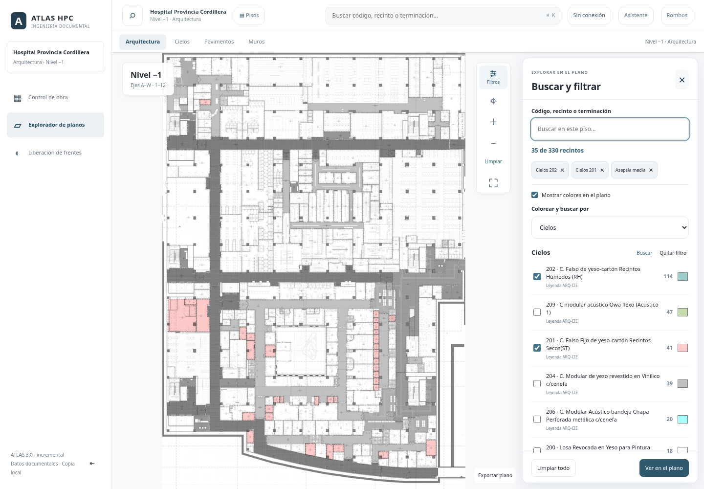
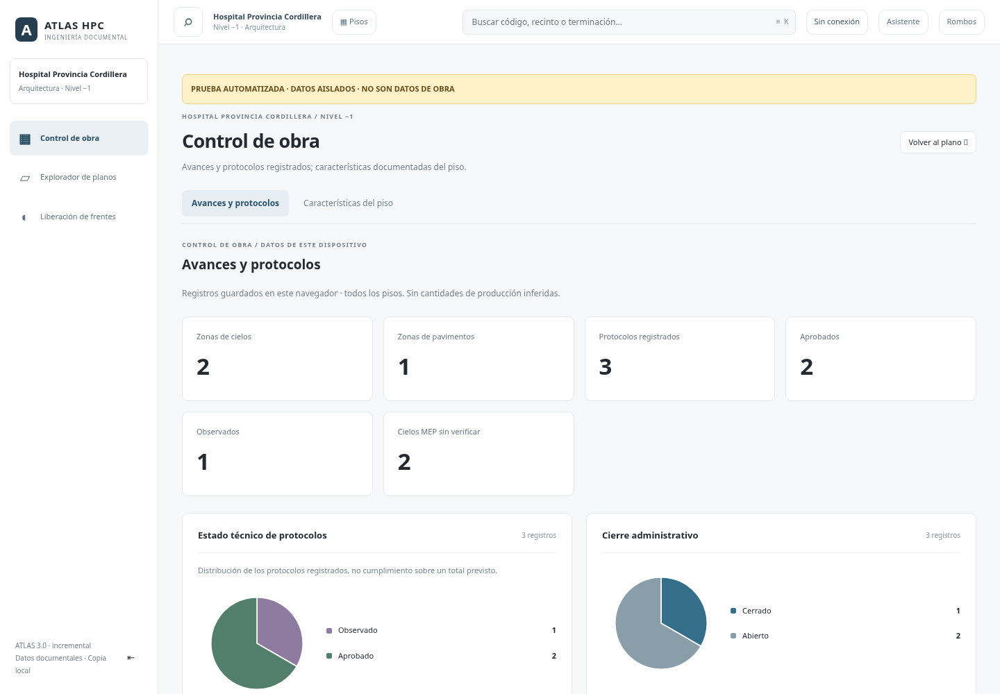

# Control de obra y búsqueda dentro del plano

La navegación principal contiene Control de obra, Explorador de planos y Liberación de frentes. La selección de piso mantiene las cuatro tarjetas existentes. No se añade un visor nuevo.

## Filtros en el plano

El botón «Filtros» de la barra derecha abre un panel junto al plano en escritorio y un panel compacto en móvil. Comparte el estado de búsqueda/colores con el visor:

- Consulta por código, nombre o terminación, sincronizada con la búsqueda superior.
- Búsqueda de categorías por texto, sin distinguir tildes; selección múltiple por familia.
- Unión dentro de una familia e intersección entre familias, asepsia, sector y revisión.
- Muros, pavimentos, cielos, liberación, asepsia, pinturas, sectores y estado de revisión. Los datos disponibles determinan las categorías.
- Total de coincidencias de la consulta; conteos de categoría identificados como totales del piso completo.
- Encendido/apagado de colores, preferencias personales, procedencia documental y restablecimiento de paleta compartidos con el modelo existente.
- Zoom conservado durante el ajuste; filtros conservados al cerrar/reabrir. Una coincidencia no interrumpe la configuración abriendo una ficha. Seleccionar un recinto en el mapa cierra el panel y permite consultar su ficha.
- Respaldo de correcciones desde «Colores y respaldo». Fuentes disponibles desde fichas y enlaces documentales, sin apartados de base de datos en el menú.

[Vista móvil](images/plan-filters-mobile.png)

## Gráficos de control

**Características del piso** es la vista documental de Control de obra.

- El panel **Avances y protocolos** se retiró de Control de obra (octubre de 2026).
- `construction-dashboard.mjs` queda en el repositorio sin usarse, y los registros locales de ese panel siguen en IndexedDB: no se borran.
- **Características del piso:** indicadores y barras documentales del piso activo. Seleccionar una categoría devuelve al plano y destaca los recintos correspondientes, también al regresar desde una especialidad.

Las tortas se usan para categorías excluyentes. Las terminaciones que pueden solaparse conservan barras. El denominador es el conjunto de registros, nunca un total previsto de obra no documentado. Sin eventos, el estado es «Sin registrar»; sin registros, el gráfico indica que no hay datos. No se calculan m² ejecutados, avance global ni cumplimiento sin bases suficientes.

La persistencia local existente se conserva: este incremento no añade sincronización entre dispositivos.

[Control sin registros en un navegador nuevo](images/work-control-empty.png)

La siguiente imagen es **evidencia de una prueba automatizada con datos aislados**, no datos de la obra. El aviso también aparece dentro de la captura. Esos registros se crean únicamente en el navegador de prueba y se eliminan al cerrar su contexto.

## Implementación y validación

- `plan-filters.mjs`: panel y controles; `workspace.mjs` conserva el estado único de filtros/paleta y organiza Control de obra.
- `work-charts.mjs`: distribuciones y gráficos SVG accesibles; `construction-dashboard.mjs` enlaza estados con registros.
- `app.js`: integración de búsqueda, cámara y fichas; `index.html`/`workspace.css`: navegación y distribución responsive.
- El manifiesto offline incluye ambos módulos nuevos. No se modifica runtime, SQLite, fuentes originales ni geometrías.

`work-charts-test.mjs` verifica deduplicación, último evento, dimensiones independientes, datos ausentes, gráficos vacíos/una categoría/varias categorías y etiquetas escapadas/accesibles.

`plan-filters-browser-test.mjs` usa el servidor real con contraseña y Chromium a 1440/390 px. Verifica tres apartados, gráficos a registros, selección de categorías, búsqueda y sincronización, filtros compuestos, colores, cámara, persistencia del panel, transición desde Cielos a pintura sobre Arquitectura y consulta propia de N02. Otro contexto con service worker se recarga sin red y comprueba filtros y Control de obra offline.

Se adaptan los tests anteriores de colores/selección, calidad, contornos y tarjetas a sus nuevos puntos de acceso. Groq usa un proveedor simulado en sus pruebas. La publicación en Render requiere revisar/fusionar la PR y desplegar main; la validación local no equivale a un despliegue en producción.
