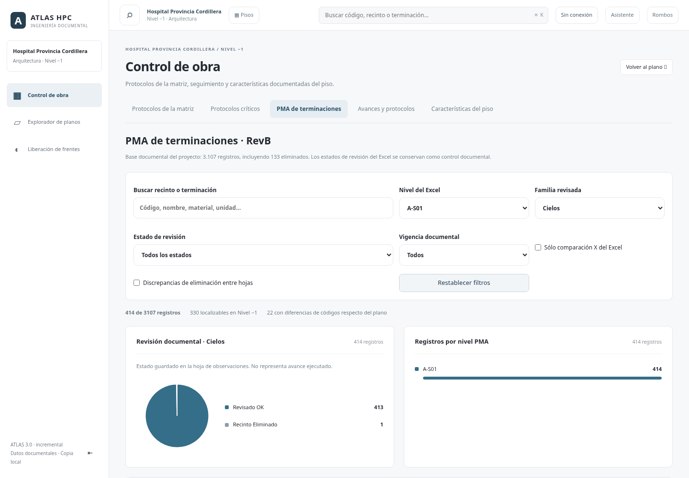

# PMA de terminaciones RevB

Se incorpora `HPC-5-ARQ-GEN-PMA-01-RevB (1).xlsx` como fuente documental de recintos y terminaciones, conservando intacto el archivo. Está disponible en **Control de obra → PMA de terminaciones** y en el desplegable **PMA de terminaciones · RevB** de las fichas del plano. La navegación principal conserva sus tres apartados.



[Consulta móvil](images/pma-mobile.png) · [Gráficos en móvil](images/pma-charts-mobile.png)

## Fuente y alcance

- Original: `dist/source/hpc-5-arq-gen-pma-01-revb.xlsx`, 3.443.274 bytes.
- SHA256: `0c9b9e20a2c1257b2390ce1cba74dc756f0e45ef036043c5f084d228715c7ea9`.
- RevB procede del nombre del archivo; no se ha identificado una fecha de emisión. La carátula lo describe como antecedente complementario del anteproyecto. No se presume que prevalece cronológicamente sobre las láminas actuales.
- 3.107 registros, incluidos 133 con nivel literal `Recintos Eliminados`. Los códigos `10.2.1`, `11.1.1` y `11.1.2` también son identidades válidas de la fuente: no se exige sufijo con guion.
- `HPC PMA TERMINACIONES`: 22 campos B–W, filas 6–3112. Código, tipología, categoría, unidad, nombre, superficie escrita, nivel, cambio, pavimento, cielo, cuatro orientaciones de muro, asepsia, codificación combinada, proyecto/referencia, comparación, comentarios, observación y respuesta.
- `01_PMA_A-TAB-000_ARQ_DataTermin`: 21 campos A–U, filas 2–3108. Se conserva como observación independiente, vinculada por código exacto y nivel.
- `HPC SE5 Obs PMA Det. Terminacio`: 14 campos A–N, filas 3–3109. Conserva estados independientes para pavimentos, cielos y muros, observaciones y respuestas.
- `CODIGOS TERMINACIONES` conserva materiales y referencias EETT; `CODIFICACIÓN MUROS`, oculta en el original, conserva combinaciones y documenta M1 = norte, M2 = oriente, M3 = sur, M4 = poniente. La carátula y sus notas se pueden consultar desde Fuente.

No se suman tres veces los recintos por aparecer en tres hojas. Las 9.321 observaciones fuente mantienen hoja, fila, contenido y hash. Los rótulos de totales se excluyen y sus dos `Grand total: 3107` se comprueban contra el número importado. Se leen valores guardados de fórmulas, sin ejecutarlas ni actualizar vínculos. Se conservan blancos, ceros y textos originales; los saltos de línea siguen la normalización del estándar XML (CRLF/CR → LF). El Excel binario descargable conserva todos sus bytes, estilos y fórmulas.

## Consulta y control

Filtros por código/texto/material/unidad, nivel literal del Excel, familia, estado de revisión, condición de eliminado, comparación X y discrepancias de eliminación entre hojas. Hay 25 registros por página, detalle de los 57 campos con su fila original, torta de revisión y barras por nivel; pulsar el gráfico aplica su filtro. No se calculan superficies a partir de polígonos ni se convierte texto superficial en cantidades de obra.

La comparación X es la del propio PMA (1.513 filas frente a 1.594 IGUAL). Es independiente de las diferencias de códigos detectadas entre PMA y rombo del plano. El usuario puede ver ambos valores, su procedencia y decidir la corrección mediante el flujo documental existente. No se reemplazan acabados, colores o geometrías automáticamente.

Los estados `Revisado OK`, `Observado`, `Revisado Diferencias Validado` y sus variantes son revisiones documentales. No se convierten en protocolos abiertos/cerrados, liberaciones MEP, validaciones geométricas ni porcentaje ejecutado. La matriz de protocolos REV1 conserva sus fechas, estados y gráfico crítico sin alteraciones.

El PMA contiene cuatro discrepancias de eliminación entre su hoja principal y la de observaciones:

| Código | Nivel principal | Cambio principal | Revisión que dice eliminado |
|---|---|---|---|
| 8.2.4.3.6-3 | A-S01 | RECINTO NUEVO | Cielos y Muros |
| CU.2.1.3-2 | A-N06 | RECINTO NUEVO | Las tres familias |
| CU.3.2.1-2 | A-N02 | RECINTO NUEVO | Las tres familias |
| CU.3.2.1-3 | A-N02 | RECINTO NUEVO | Las tres familias |

Se pueden filtrar y consultar ambas versiones. Los 133 eliminados son los de la columna NIVEL principal; no se oculta la diferencia con 136/137 estados de revisión que dicen eliminado.

## Cruce con los planos

La relación usa código exacto, permitiendo solo espacios exteriores, y el mapa explícito `N-1 → A-S01`, `N02 → A-N02`. No se equiparan A-N02 y C-N02 ni se hace asociación por parecido del nombre. Un eliminado o un código de otro nivel no recibe enlace navegable al plano actual. Varias observaciones activas requieren resolver la correspondencia y no se elige una silenciosamente.

- Nivel −1: las 443 observaciones ARQ tienen coincidencia por código y nivel. En el ámbito canónico visible son 330 recintos localizables, 22 con alguna diferencia PAV/CIE/M1–M4 respecto de su ficha actual. Las 443 observaciones completas contienen 32 diferencias; no es un conteo de recintos distintos ni de errores confirmados.
- Nivel 2: 307 de 311 registros del plano coinciden por código y nivel; siete tienen diferencias de códigos. Cuatro códigos (`4.1.1.1.1-1`, `4.1.1.1.6-1`, `4.1.1.1.7-1`, `4.1.1.2.6-1`) están en A-N01 según el PMA. Se muestra el conflicto y no se reasignan al piso 2.
- La base aporta datos documentales para pisos 1 y 3, pero no geometrías ni imágenes de esos pisos. Sus tarjetas siguen pendientes de plano.

El asistente Groq recibe la observación PMA, leyendas de sus códigos, revisión documental y fila de procedencia desde el servidor cuando hay recinto seleccionado. Un candidato de otro nivel se identifica como tal, sin atribuirle la ficha. El navegador no puede inyectar un registro PMA de confianza. No se envía toda la matriz en cada consulta. La prueba usa proveedor simulado, sin consumir una API real.

## Importación, SQLite y offline

```bash
python scripts/import-pma.py
node scripts/prepare-offline.mjs
node pma-test.mjs
python pma-import-test.py
PLAYWRIGHT_MODULE=/ruta/a/playwright-core/index.mjs node pma-browser-test.mjs
```

El importador permite argumentos `[source.xlsx] [output-dir] [derived.sqlite]`. Valida cabeceras, códigos únicos, niveles, correspondencia de hojas y totales antes de reemplazar derivados. Una fuente incompatible no sustituye la salida válida. Los originales Atlas están expresamente protegidos como destino.

- `dist/pma/catalog.json`: valores agrupados en un diccionario, tres conjuntos de observaciones, leyendas, metadatos y auditoría; aproximadamente 1 MiB.
- `data/pma-revb.sqlite`: instantánea documental separada y reproducible, con `pma_sources`, `pma_observations`, `pma_legends`; esquema en `migrations/004_pma_snapshot.sql`. No se aplica esta migración a las bases Atlas originales. Es una base derivada para consulta/importaciones, no un servicio de edición compartida.
- `pma-model.mjs`: validación, relaciones, diferencias, búsqueda y filtrado. `pma.mjs`: controles y ficha, caché en memoria con reintento y protección ante respuestas tardías. No modifica los recintos cargados ni localStorage/IndexedDB de correcciones.
- Datos PMA se descargan al abrir su pestaña o desplegar el apartado en una ficha. No se descarga ni analiza el Excel para abrir el plano. Los módulos están en el núcleo offline y el catálogo en «Guardar plano y fichas». Una consulta ya realizada también queda en caché; el original se guarda aparte en «Documentos originales».
- Filtros/selección se recuerdan en `atlas-pma-view-v1`, vinculados al hash de la fuente y piso activo.

Pruebas: comparación independiente SheetJS de 177.099 campos, leyendas y orientaciones; totales, eliminados, contradicciones y asociaciones exactas; descarga con SHA idéntico y acceso protegido; contexto Groq de servidor. Python verifica 9.321 observaciones SQLite, cada payload contra JSON, integridad, claves foráneas, reproducibilidad binaria y protección de originales/fallo de esquema. Chromium cubre escritorio/móvil, gráficos, filtros, paginación, estado persistido, 57 campos, enlaces a ficha, conflicto de nivel, carga diferida, descarga, reintento, respuesta tardía y recarga real sin red.

Publicación: revisar y fusionar la PR en GitHub y luego **Manual Deploy → Deploy latest commit** del servicio Render configurado en **main**. No cambiar la rama del servicio. Si una pestaña antigua conserva la versión previa, usar `/actualizar.html`; no borrar datos del sitio porque contienen correcciones locales.
