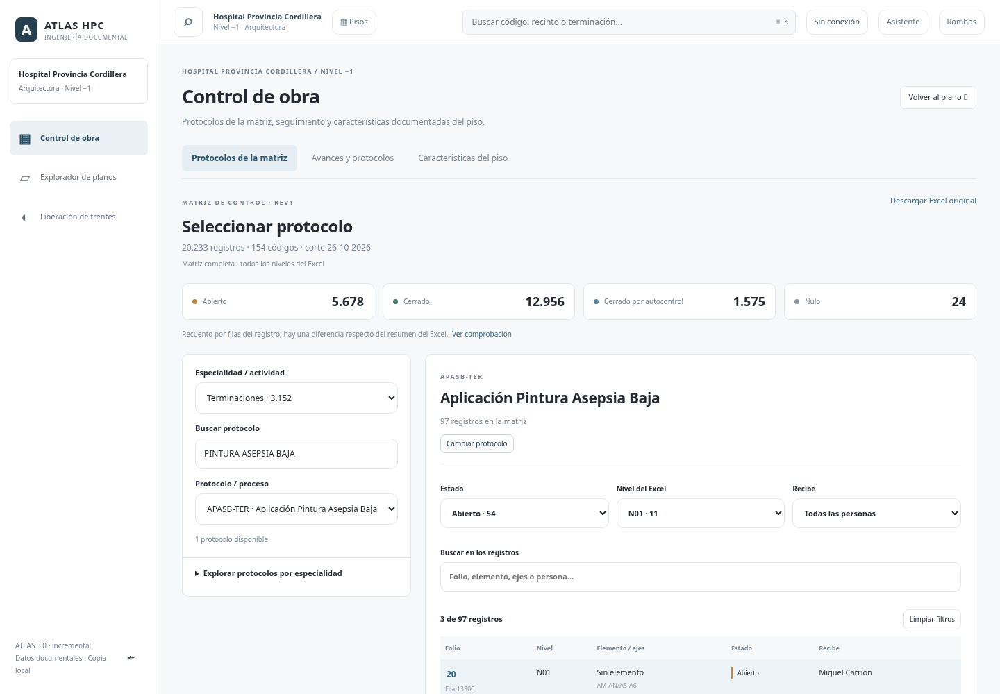

# Matriz de control de protocolos REV1

## Fuente incorporada

- Original conservado: `dist/source/matriz-control-protocolos-rev1-hpc.xlsx`.
- SHA256: `e8f7774c964166450ff9546abb1cabc92cb9d2344144e82ace424df6d2c6a9ef`.
- Corte guardado en el Excel: 26-10-2026. REV1 corresponde al nombre del archivo, sin atribuir esa revisión a cada formato de protocolo.
- Registro maestro: `2-CORRELATIVO DE PROTOCOLOS HPC`, hoja ID 64, filas 3–20235.
- 20.233 registros; 154 códigos y 156 variantes originales de nombre de proceso. Agrupación de especialidades: 38, mediante normalización textual de espacios, mayúsculas y tildes. Las etiquetas originales permanecen en los registros y en las variantes del catálogo.
- Se usa `1-RESUMEN GENERAL HPC` como control. No se suman tablas dinámicas ni hojas históricas ocultas; el Excel descargable las conserva.

La matriz es un registro documental de seguimiento. No contiene todos los formatos y puntos de inspección de cada protocolo. No se inventan formularios de ejecución, resultados o aprobaciones técnicas.

## Uso

En Control de obra se abre **Protocolos de la matriz**. Seleccionar especialidad y buscar por nombre/código; elegir un proceso en el desplegable o explorar los paneles por especialidad. Ejemplos reales:

| Código | Nombre de proceso guardado | Registros |
|---|---|---:|
| APASB-TER | Aplicación Pintura Asepsia Baja | 97 |
| APASM-TER | Aplicación Pintura Asepsia Media | 44 |
| IPCT2-TER | Instalacion De Primera Cara Planchas XR-RH | 170 |

Al seleccionar se carga únicamente su detalle. Se puede filtrar por estado, nivel literal del Excel, persona que recibe y texto; recorrer páginas de 25 filas; desplegar un folio para ver sus 16 campos y fila fuente. La selección, filtros y página se recuerdan en este navegador y se restablecen al cambiar la versión de la fuente. «Cambiar protocolo» vuelve a los selectores.

[Consulta móvil](images/protocol-matrix-mobile.png)

La matriz se consulta sin editarla. Los protocolos locales y su historial existentes en IndexedDB siguen independientes y disponibles en Avances y protocolos. No se insertan automáticamente veinte mil registros en esa base ni se confunde un estado CERRADO del Excel con una aprobación técnica local.

## Datos conservados y diferencias

Cada registro mantiene ITEM GRAL, ESPECIALIDAD / ACTIVIDAD, PARTIDAS / PROCESO, CODIGO, FOLIO, ELEMENTO, NIVEL, EJES, RECINTOS, FECHA DE ELABORACIÓN, AUTOCONTROL, CERRADO, FECHA DE CIERRE, Mes, RECIBE y ESTADO, incluyendo blancos y espacios del valor original. Fechas visibles se convierten desde su serial Excel; no se sustituyen ausencias por la fecha actual.

Estados agrupados por filas:

| Estado | Filas |
|---|---:|
| Abierto | 5.678 |
| Cerrado | 12.956 |
| Cerrado por autocontrol | 1.575 |
| Nulo | 24 |
| Total | 20.233 |

El resumen declara 5.675 abiertos. Las filas 20026, 20033 y 20112 contienen `ABIERTO ` con espacio final: se agrupan para consulta y se informa la diferencia, sin corregir el archivo ni reemplazar el valor raw.

Hay 17 combinaciones repetidas de código/folio y una fila sin especialidad documentada. Se conservan todas las filas. La identidad usa hash de la fuente + hoja + fila, no código/folio. Los nombres y niveles no se convierten automáticamente en códigos de recinto ni se vinculan a polígonos. Las ubicaciones de la matriz abarcan más niveles que los planos cargados en Atlas.

## Derivados, carga y offline

`scripts/import-protocol-matrix.py` utiliza ZIP/XML de la biblioteca estándar de Python, verifica cabeceras y totales antes de escribir y extrae valores guardados. No ejecuta fórmulas, macros, vínculos ni instrucciones dentro del documento. No modifica el original ni las bases SQLite.

- `dist/protocols/catalog.json`: índice, procedencia, agrupaciones, recuentos y diferencias.
- `dist/protocols/open-aging.json`: índice compacto de abiertos para antigüedad; conserva fechas/estados raw y apunta a su código y fila.
- `dist/protocols/registers/protocol-*.json`: 154 conjuntos por código, con strings agrupados y las filas originales.
- `protocol-model.mjs`: decodificación con validación de versión/esquema, filtros, fechas y paginación.
- `protocol-catalog.mjs`: paneles, selección, carga bajo demanda, caché limitada, reintentos y protección frente a respuestas tardías.

El índice y módulos forman parte del núcleo offline; todos los detalles están en «Guardar plano y fichas». Un detalle ya consultado también se conserva en caché. Para consultar cualquier protocolo sin señal, completar ese paquete. El Excel original se descarga aparte en «Documentos originales». Servidor protege índice, detalles y original con el mismo acceso de Atlas.

## Regeneración y revisión

1. Conservar el nuevo archivo autorizado en la ruta de fuente; revisar su estructura y fecha de corte. No reemplazar fuentes sin autorización.
2. Ejecutar `python scripts/import-protocol-matrix.py` y revisar el resumen emitido. El importador rechaza cambios de cabeceras y discrepancias en el total declarado para revisión.
3. Ejecutar `node scripts/prepare-offline.mjs`.
4. Actualizar y revisar las expectativas de fuente de `protocol-matrix-test.mjs` cuando cambie legítimamente el Excel; ejecutar ese test y `python protocol-import-test.py`.
5. Ejecutar `PLAYWRIGHT_MODULE=<ruta-a-playwright-core> node protocol-matrix-browser-test.mjs` y presentar los cambios en PR. Render permanece en main tras revisión/fusión; no hay publicación automática.

La regeneración no incluye fecha de ejecución y usa orden determinista. Las salidas de prueba se escriben en directorios temporales. SQLite, geometrías y fuentes previas no se reescriben.

## Validación

`protocol-matrix-test.mjs` usa SheetJS como lector independiente y compara los 16 campos de cada una de las 20.233 filas con el Excel original. Verifica búsquedas, recuentos, duplicados, fechas, paginación, identidad, versión/esquema, paquetes offline y descarga protegida idéntica al original. Se ejecuta en el build de Render.

`protocol-import-test.py` verifica repetibilidad con dos semillas de hash y que un total incompatible no modifique derivados válidos.

`protocol-matrix-browser-test.mjs` usa Node protegido y Chromium real en escritorio/móvil: carga diferida, desplegables/paneles, filtros, ficha inline, paginación, persistencia sin sobrescribir datos locales, resultados vacíos, descarga, reintentos, respuesta atrasada y recarga con el service worker activo y red deshabilitada. Las capturas muestran registros reales del archivo; los únicos registros de prueba locales quedan aislados en el contexto del navegador y no se incorporan al programa.

Filtros de fechas y análisis posterior: [CRITICAL_PROTOCOLS.md](CRITICAL_PROTOCOLS.md).
