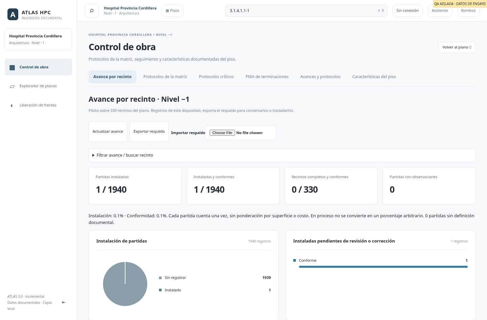

# Piloto de avance por recinto · nivel −1

Control de obra muestra el checklist y los indicadores de los recintos del piso activo: −1, 1, 2 o 3. Cada piso se cruza con su nivel PMA (A-S01, A-N01, A-N02 o A-N03). Los registros sin correspondencia válida se informan y no generan partidas. No se trasladan estados de un piso a otro.

El panel local Avances y protocolos (retirado de Control de obra en octubre de 2026) también limitaba zonas, eventos y protocolos a los recintos del piso. Los registros antiguos solo se asignan cuando la lámina o una identidad de recinto única permite determinar el piso; los ambiguos se excluyen con aviso. El avance valorizado conserva su alcance documental de nivel −1.

## Rombo interactivo: avance y observaciones juntos

La ficha del recinto abre con su **rombo**, dibujado como en las láminas: M1 arriba, M2 a la derecha, M3 abajo, M4 a la izquierda, cielo al centro arriba y pavimento al centro abajo, cada sección con su código. Desde octubre de 2026 las tarjetas de Avance y de Observaciones de Control de obra son una sola, **Avance y observaciones**.

- **Color = estado de ejecución** de la partida: blanco sin registrar, gris no iniciado, ámbar en proceso, azul instalado por revisar, rojo con observaciones, verde instalado y conforme, rayado no aplica. Un número rojo cuenta las observaciones en terreno pendientes de ese elemento.
- **Tocar una sección** despliega su checklist: Ejecución (No iniciado, En proceso, Instalado) y Revisión (Sin revisar, Con observaciones, Conforme). Tocar un estado **lo guarda al instante** y el rombo cambia de color; Qué falta y la observación de la partida se guardan con «Guardar notas». Mismas reglas del registro: conforme solo instalada y sin faltantes; con observaciones exige la nota (se pide y se aplica al guardarla); bajar de instalada quita la conformidad.
- Cada guardado es una nueva versión del registro del recinto con el responsable (se recuerda en el equipo) y la fecha de hoy; las demás partidas conservan lo guardado. Si hay diferencias documentales, se pide marcar el cotejo antes.
- Debajo del checklist están las observaciones de ese elemento y «+ Observación con foto» con el elemento ya elegido.
- **Ficha del recinto (desde octubre de 2026):** arriba las observaciones en terreno, con sus fotos en grande, y debajo el rombo interactivo; luego protocolos y la leyenda de terminaciones. Se retiraron el rombo estático (imagen y «ver original»), el checklist completo con su formulario, el desplegable PMA, la asepsia documentada y el aviso de contorno técnico: el rombo cumple la función del checklist. El historial de versiones se sigue guardando y viaja en el respaldo de avance.

En **Avance por recinto**, los recintos van en una tabla con una columna por partida, con los colores del rombo, más sector, situación, observaciones pendientes y asepsia. Los encabezados filtran y ordenan como en Excel, y los indicadores y gráficos siguen a la tabla. Tocar un recinto abre su rombo debajo. Las pruebas están en `rombo-test.mjs`.

## Registro en terreno

Desde el rombo (en la ficha del plano o desde la tabla de Control de obra) se usa este registro:

- Pavimento, cielo y muros norte, oriente, sur y poniente, con código/material PMA y asepsia requerida de pintura.
- Instalación: Sin registrar, No iniciado, En proceso, Instalado.
- Condición: Sin revisar, Con observaciones, Conforme. Conforme exige Instalado y ningún faltante declarado. Con observaciones exige una observación escrita.
- Faltantes y observaciones por partida, observaciones generales del recinto, responsable y fecha de revisión.
- Historial de versiones, estados anteriores y notas. La fecha de terreno es editable; la hora de guardado se conserva aparte.

Las orientaciones vienen de CODIFICACIÓN MUROS del PMA. No se crean tareas de asepsia adicionales: es un requisito de la terminación. Se registra el resultado de cada terminación; el desglose de estructura, placas, manos de pintura y mediciones parciales queda para otra iteración con criterios acordados.

No aplica (`N/A` o `-`) se muestra y excluye del denominador. Códigos sin definición documental no permiten registrar instalación y bloquean la declaración de recinto completo. Una diferencia de códigos PMA/plano o de eliminación exige cotejo explícito en el formulario antes de guardar; ese cotejo no cambia las fuentes ni resuelve automáticamente el conflicto documental.

## Análisis de avance

1. **Instalación de partidas:** torta con Sin registrar, No iniciado, En proceso e Instalado. Permite distinguir falta de levantamiento de trabajo expresamente no iniciado.
2. **Avance por partida:** seis barras con instaladas / conformes / total aplicable, visibles incluso con cero instalaciones. Compara pavimentos, cielos y orientaciones de muro.
3. **Instaladas pendientes de revisión o corrección:** separa Sin revisar, Con observaciones y Conforme dentro de lo ya instalado.
4. **Trabajo pendiente por sector:** ordena la cantidad de partidas que aún no están instaladas y conformes para orientar las próximas visitas.

Los indicadores, estados de la torta/barras, familias y sectores permiten abrir un listado de evidencia. El detalle muestra partidas, recinto, material, instalación, condición, faltantes/notas y última revisión. Se pagina a 25 filas y permite abrir el editor de avance o la ficha en el plano. La consulta del detalle conserva el denominador del dashboard; los filtros generales de piso, sector, familia, asepsia y búsqueda sí delimitan el conjunto. Los recintos completos se determinan con todas sus partidas aplicables, incluso al seleccionar una familia.

**Cobertura del levantamiento:** partidas con estado de instalación distinto de Sin registrar / partidas aplicables documentadas del conjunto. Distingue falta de datos de trabajo expresamente no iniciado. Los registros de fuente cambiada quedan Sin registrar hasta cotejar; no cuentan como ejecución ni muestran una fecha vigente en el detalle. Las partidas desconocidas o sin correspondencia PMA se mantienen fuera de la base y con aviso. El estado de pagos permanece en su acceso personal protegido y no se consulta desde este dashboard.

Indicadores: partidas instaladas, instaladas y conformes, recintos completos y conformes, partidas con observaciones. Los filtros (recinto, sector, estado de cada partida, situación del recinto, observaciones pendientes y asepsia) están en los encabezados de la tabla de recintos, como en Excel; la partida se elige tocándola en «Avance por partida» (otra vez para volver a todas).

El porcentaje usa partidas aplicables documentadas como denominador, con el mismo peso por partida. **No es porcentaje físico ponderado por m², costo ni esfuerzo.** En proceso no se convierte en un 50%. Un recinto completo exige todas sus terminaciones aplicables instaladas y conformes; seleccionar una familia no cambia esa definición. No se reutilizan los estados Revisado OK del Excel como avance ejecutado y no se cierran protocolos automáticamente.

La evolución semanal y los tiempos de resolución de observaciones son próximos análisis útiles. No se dibuja una curva histórica ficticia a partir de la última revisión documental. El historial de este piloto prepara esa información; primero se necesita continuidad en los registros reales.

## Conservación, borradores y alcance del piloto

- Almacenamiento IndexedDB **atlas-room-progress**, independiente de fuentes, geometrías y protocolos existentes. Clave `piso|código` (las claves existentes `N-1|código` se conservan), con tabla rooms e historial append-only. No se escribe en el disco efímero de Render.
- **Los avances son locales al navegador/dispositivo. No hay sincronización compartida entre usuarios.** Exportar respaldo conserva registros e historial del piso activo en JSON; importar agrega datos y permite repetir el mismo respaldo. Si un registro existente difiere, se rechaza toda la importación para evitar sobrescribir el trabajo local. No se fusionan ediciones divergentes automáticamente.
- Guardado atómico de ficha e historial, con versión esperada para detectar modificaciones en otra pestaña. Actualizar avance vuelve a leer los registros. Las fichas abiertas reciben el cambio realizado en el mismo documento.
- Borrador de formulario en sessionStorage, recuperable al regresar al recinto o recargar esa pestaña. No cuenta en gráficos hasta Guardar avance. Un borrador de otra versión se puede descargar o descartar; el formulario se bloquea hasta resolverlo para evitar sobrescribirlo. El borrador no sustituye un guardado ni un respaldo.
- Hash de PMA y códigos de partida conservados en cada revisión. Si cambian, los estados anteriores quedan en historial y se presentan sin registro vigente hasta cotejar y guardar contra la nueva fuente.
- Módulos en el núcleo offline. El PMA consultado queda en caché; completar Guardar plano y fichas permite preparar el piloto sin conexión. Registro offline, historial y exportación operan en el dispositivo.
- El asistente Groq conserva su consulta documental actual; no recibe estos avances locales automáticamente.

## Implementación y validación

- `dist/room-progress-model.mjs`: requisitos, validación y métricas.
- `dist/room-progress-store.mjs`: persistencia, control de versiones, historial y respaldos.
- `dist/room-progress.mjs`: control, gráficos y editor compartido por ficha/control.
- `dist/workspace.mjs`, `dist/app.js`, `dist/workspace.css`: integración y disposición móvil.
- `scripts/prepare-offline.mjs`, `dist/sw.js`, `render.yaml`: publicación/cache y prueba del modelo en build.
- `room-progress-test.mjs`: PMA real, denominadores, instalación versus conformidad, aplicación N/A, fuente cambiada y validación de estados/fechas.
- `room-progress-browser-test.mjs`: escritorio/móvil, registro desde Control y ficha, recuperación/descartar borrador, historial, conflicto entre versiones, respaldo idempotente/rechazo atómico de conflicto y recarga offline real.

Capturas con datos aislados de ensayo, nunca incorporados al catálogo publicado:

[Control móvil, datos QA](images/room-progress-mobile.png)

Publicación mediante PR revisada a main y Manual Deploy en Render. La rama del servicio sigue siendo main. Ante una pestaña con versión antigua, usar `/actualizar.html`, conservando los datos del sitio.

## Orientación de los próximos análisis

Los dashboards de ejecución deberían responder qué falta, dónde y qué registro lo respalda. Esta mejora convierte los gráficos existentes en consultas de partidas; no añade otro panel documental ni restaura PMA de terminaciones.

- Checklist: instalación, conformidad y cobertura, con detalle por familia/sector/recinto, según el piso activo. Datos locales del equipo actual.
- Observaciones: pendientes por responsable, vencimientos y corregidas esperando verificar, con fotos y su propio historial. Sincronización según la sesión Nube. No se deduce conformidad del checklist solo por cerrar una observación.
- Protocolos: abiertos, críticos y datos para Revisar, conservando la fecha de corte del Excel. Un protocolo cerrado no convierte automáticamente una partida en instalada.
- Pagos: subtotal/retención/neto y versiones por subcontratista, dentro del acceso protegido. Aprobado es estado de aprobación, no comprobante de transferencia ni porcentaje físico.
- Evolución semanal y comparación contra metas necesitan cortes fechados y metas acordadas. No se presentan tendencias, retrasos de planificación ni valor ganado a partir de un único estado o de cantidades sin validar.
