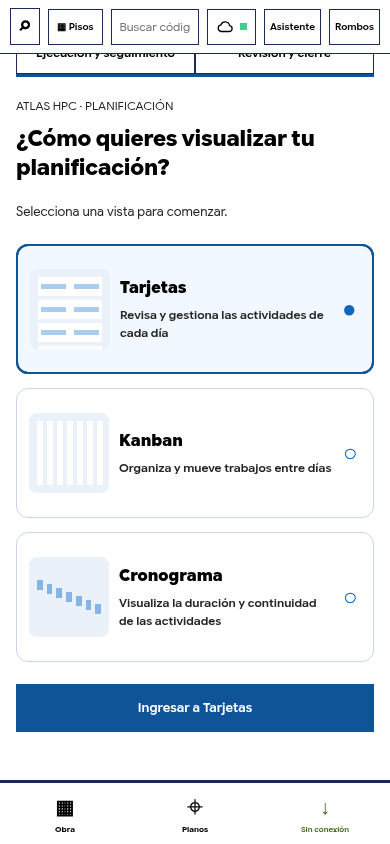
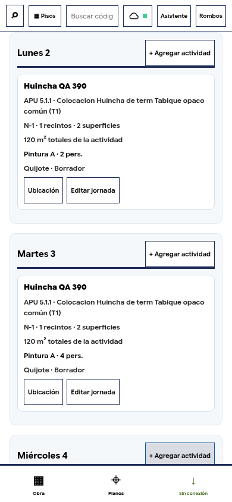
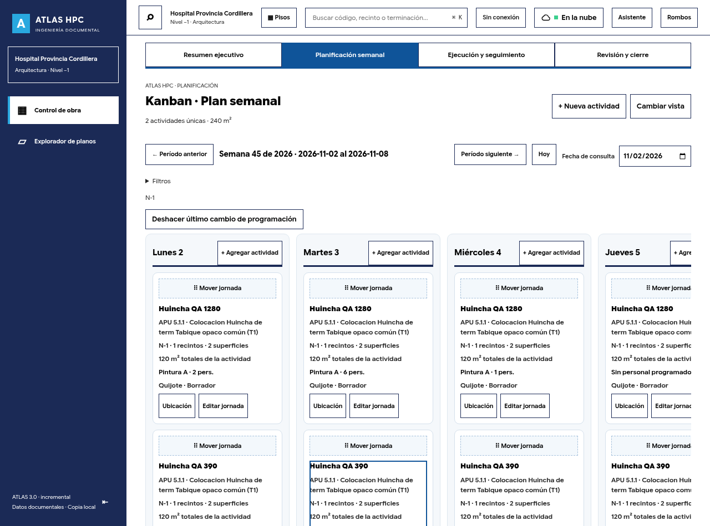
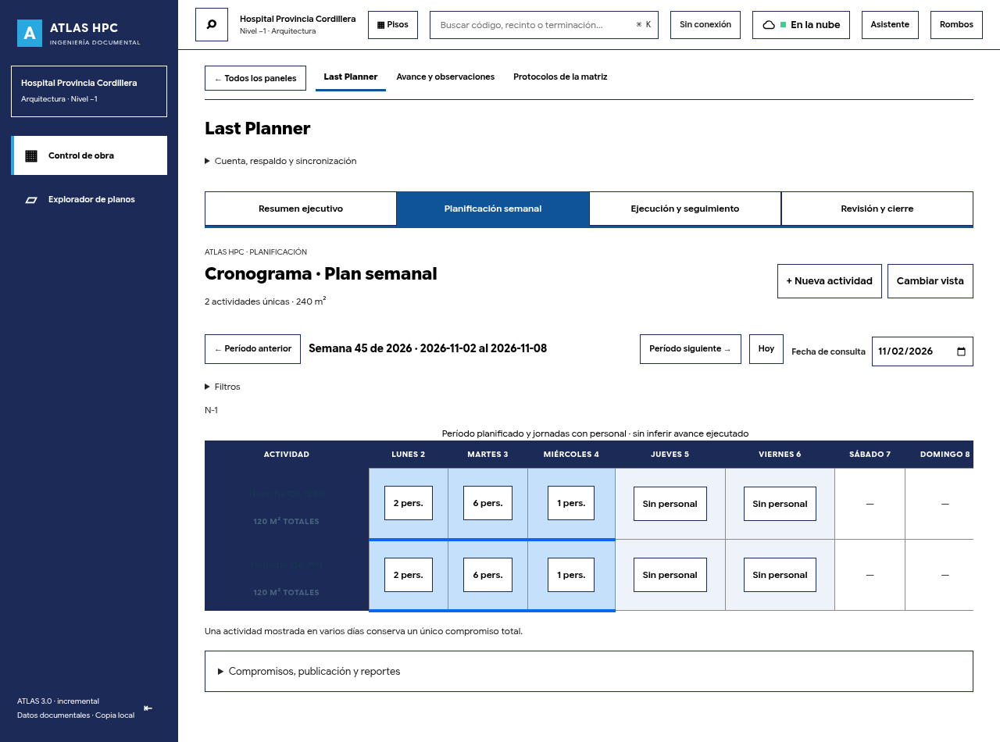

# ATLAS HPC 4.0 — entrega funcional

## Resultado y estado

Se amplía el Last Planner existente: **una colección de actividades y asignaciones, tres representaciones**. Se integró el APU real entregado, no un catálogo de demostración. La aplicación sigue usando sus módulos JavaScript nativos, Node, IndexedDB y la sincronización Supabase existentes; no se migró a React/TypeScript ni se añadió un segundo visor.

| Área | Estado comprobado |
|---|---|
| Elección de vista | Tres tarjetas con miniaturas abstractas, selección explícita y botón «Ingresar». Cambiar tarjeta no navega. Preferencia local y «Cambiar vista». |
| Tarjetas | Siete jornadas, cantidades identificadas como total de actividad, equipos y personal diario, ubicación, APU, restricciones y detalle contextual. |
| Kanban | Siete columnas con desplazamiento interno; control de arrastre «Mover jornada», alternativa mediante formulario, confirmación, duplicados y deshacer. |
| Cronograma | Filas de actividad, período diferenciado de jornadas con personal; días sin personal explícitos. No representa avance por transcurso del tiempo. |
| Filtros | Una función compartida para piso, empresa participante, especialidad, equipo, responsable, estado y restricciones. Se conserva semana/filtros al cambiar vista. |
| Edición rápida | Persona/dotación, equipo, empresa, fecha y copia por asignación. Conserva otras jornadas, cantidad y superficies. |
| Reordenación | Subir prioridad de una actividad en una jornada desde el detalle; Tarjetas y Kanban consumen el mismo orden persistido. |
| Reprogramación | Mover/copia de jornada dentro del período; cambiar período de un borrador semanal independiente con vista previa; revisiones publicadas siguen autorizadas y mantienen el original. |
| Creación | El día inicia el asistente de cuatro pasos. Fechas en Trabajo, búsqueda APU, visor dedicado, cantidad/equipos y revisión. Vuelve a la misma representación. |
| Ubicación | Visor y geometrías existentes, Norte/Sur/Este/Oeste con ejes calibrados, selección azul persistida, grupos desplegables para múltiples tramos/diagonales. |
| APU | Catálogo completo, búsquedas por código/texto/capítulos/operaciones, recursos, coeficientes originales, versión/fila/hash y selección real persistida. |
| Motor de productividad | Calcula con modelos aprobados suministrados al motor o historial verificado comparable; requiere unidades/horas/composición suficientes. Sin datos válidos no muestra una producción ficticia. |
| Seguimiento | Se conserva asistencia, ejecución, evidencia, restricciones, verificación, PPC, cierre y saldo. El historial se deriva de ejecución cerrada y verificada. |
| Concurrencia/roles | Se reutilizan versiones, cola, control de cambios y permisos. Backend comprueba que la asociación APU coincida con el catálogo inmutable. |

## APU real: alcance de la importación

Fuente: **APU.xlsx — Hospital Provincia Cordillera**, hoja `APU`, 26.920 filas. El hash SHA-256 completo y la versión activa están en `dist/apu/index.json` y `dist/apu/audit.json`.

- **878 capítulos**.
- **4.142 partidas** con identificadores por código/fila; no se sobrescriben por coincidencias de código.
- **12.202 relaciones partida–recurso**: 4.307 materiales, 4.084 mano de obra, 3.807 maquinaria y 4 otros.
- **0 recursos huérfanos**.
- **3.980 referencias de partidas seleccionables**; esto no significa que tengan productividad personal aprobada.
- **25 partidas contrastadas documentalmente**, con **97 operaciones de mano de obra** seleccionables.
- **3.987 candidatos de operación pendientes de revisión documental**. Se conserva su origen, pero no se habilitan como operaciones verificadas.
- **0 rendimientos APU por persona técnicamente habilitados**: todos los recursos laborales usan `Dia`/`dia` sin composición de cuadrilla verificada. No se utilizó el precio diario para deducir personas.

La muestra abarca tabiques (5.1.1 y 5.1.3–5.1.9), pavimentos vinílicos (6.1.4.1–6.1.4.5), empaste/revestimientos (6.2.2–6.2.4), cielos (6.3.2–6.3.4) y pinturas de muros/cielos (6.4.1.1–6.4.1.3 y 6.4.2.1–6.4.2.3). El informe de importación enumera cada descripción, fila y coeficiente. Esta revisión documental no es una certificación de composición ni de rendimiento de cuadrillas.

Ejemplo comprobado: la partida **5.1.1, Tabique opaco común (T1)** contiene la operación **Colocacion Huincha de term Tabique opaco común (T1)**, recurso `MO511E`, fila **991**, coeficiente **0,010 Dia de recurso por m2**. Se conserva esta dimensión; no se presenta su inverso como m²/persona-jornada.

### Inconsistencias y controles

- 26 partidas describen ítems eliminados.
- 90 no tienen unidad, 161 no tienen precio positivo y 162 carecen de recursos. Estos conjuntos se solapan y no deben sumarse como incidencias independientes.
- Las referencias con estas incidencias quedan deshabilitadas; los capítulos no se ofrecen como partidas ejecutables.
- 40 códigos de recursos empiezan por `MA` aunque su naturaleza documental sea «Mano de obra»: se preserva la columna original y se registra la discrepancia, sin inferir la naturaleza solo desde el prefijo.
- Se inspeccionaron 19.269 celdas de fórmula y se recalcularon subtotales mediante coeficiente × precio de recurso. 4.141 partidas fueron consistentes dentro de tolerancias de redondeo; la restante corresponde a un ítem eliminado sin recursos.
- Los importes monetarios se leyeron y comprobaron durante la importación; el catálogo técnico público no incluye precios ni el Excel financiero completo. No se sobrescribió el catálogo de precios de estados de pago, que no representa estas relaciones APU.

### Reproducibilidad y reversión

```sh
python -m pip install -r scripts/requirements-apu.txt
python scripts/import-apu.py /ruta/APU.xlsx
```

La misma fuente con el mismo importador produce archivos idénticos byte a byte. El catálogo de cada versión es inmutable: un contenido distinto no sobrescribe silenciosamente una importación existente. La versión de parser es `01`; el hash del script y las referencias de celdas se conservan en la auditoría. Nuevas fuentes generan otros archivos/versiones. Para revertir una activación se restaura `index.json`, conservando los catálogos referenciados por actividades históricas.

La importación no depende de Python en Render: los artefactos técnicos ya están incluidos en el repositorio. El Excel original permanece como archivo fuente del usuario.

## Modelo y persistencia

Se extiende `planificacion` dentro de la actividad existente:

- `apu`: versión documental, hash, partida estable, operación/recurso estable, fila, coeficiente y unidades originales.
- `schedule`: asignaciones diarias existentes, con empresa/equipo, personas, fracción y horas explícitas cuando están disponibles.
- `dayOrder`: prioridad por jornada.
- `estimateReference`: referencia observada y trazabilidad del cálculo cuando existe base suficiente.

No se crearon tablas ni un nuevo sistema de restricciones. Las selecciones siguen en `alcances` y `recintos`. Publicar congela los nuevos datos en el compromiso original; editar un publicado exige revisión y motivo. Las operaciones rápidas usan el mismo guardado transaccional y control de versión.

El catálogo APU es una importación documental compartida e inmutable, cargada al buscar/consultar APU. Su hash se verifica en el navegador y el backend contrasta la referencia seleccionada antes de sincronizarla. Las vistas no solicitan geometrías adicionales; el visor del nivel actual mantiene la carga inicial propia de la aplicación.

El guardado confirma la transacción de IndexedDB y la interfaz lo identifica como guardado en este equipo. **La confirmación remota sigue ocurriendo mediante Nube**, con su cola y resolución de conflictos. No se muestra una confirmación remota antes de recibirla.

## Productividad: lo disponible y lo bloqueado

El motor tiene dos direcciones de cálculo: recursos programados → capacidad; cantidad → jornadas/horas requeridas. También compara déficit y estima fecha de término si la capacidad acumulada de las asignaciones alcanza el compromiso. Una proyección no se guarda como cantidad ejecutada.

El historial utiliza únicamente actividades cerradas, mediciones validadas y horas reales positivas asignadas. Incluye jornadas improductivas con horas asignadas, excluye registros sustituidos y registra personas/horas por día. Se compara partida, operación/versionado APU, unidad, contratista real, conjunto de equipos y condiciones documentadas. No se atribuye un resultado de varias empresas arbitrariamente a una de ellas.

Con tres o más antecedentes comparables se obtiene una media ponderada por horas, con muestra, rango y IDs de origen. No se extrapola automáticamente a dotaciones fuera del rango observado. No se mezcla con el coeficiente APU ni se convierte en una aprobación técnica universal. No se emplean tasas provisionales por equipo como si fueran modelos validados.

**Pendiente por información técnica ausente:** composición de los recursos `Dia` del APU, alturas verificadas, calendario de excepciones/feriados, disponibilidad nominativa y horarios completos de los equipos. Las coincidencias de equipo/fecha se presentan como posibles incompatibilidades. Los rendimientos reales por cuadrilla requieren datos reales de composición/jornadas de cuadrilla que no están documentados suficientemente en los registros actuales.

La selección espacial funciona sin alturas. Los tramos del contorno no se presentan como objetos BIM físicos verificados. Las condiciones de cielos y las restricciones existentes se conservan.

## Compatibilidad y límites de reprogramación

Se conserva el modelo anterior de compromisos semanales y tramos vinculados. Si una nueva actividad cruza semanas, se distribuye explícitamente su cantidad entre tramos y las asignaciones se filtran a sus fechas, sin duplicar recursos ni cantidades. Los totales de actividades reconocen el identificador de grupo.

La reprogramación completa automática está habilitada para borradores semanales independientes. Los grupos se administran mediante la distribución existente. Un publicado conserva su semana/original: permite revisión autorizada dentro de esas reglas y, tras el incumplimiento verificado, reprogramar el saldo mediante el flujo existente. **No se habilitó mover silenciosamente un compromiso publicado a otra semana** ni alterar su ejecución real. Esta restricción protege el PPC y los históricos.

## Archivos principales

Nuevos:

- `scripts/import-apu.py`, `scripts/requirements-apu.txt`.
- `dist/apu/index.json`, catálogo versionado y `dist/apu/audit.json`.
- `dist/apu-model.mjs`, `dist/apu-picker.mjs`.
- `dist/lastplanner-planning-model.mjs`, `dist/lastplanner-planning-ui.mjs`, `dist/lastplanner-productivity.mjs`.
- `server/apu.mjs`.
- `lastplanner-4-planning-test.mjs`, `lastplanner-4-browser-test.mjs`, `apu-api-test.mjs`, `test-support/planning-browser.mjs`.

Integración: workflow, asistente, recursos, programación diaria, observaciones de productividad, visor/editor contextual de superficies, estilos, validación backend, pruebas existentes, cadena Render y manifiesto sin conexión.

## Pruebas ejecutadas

- **41 comprobaciones** de la cadena de Render: regresiones existentes más modelo de tres vistas/APU y backend de referencias.
- Importación repetida contra el Excel real: igualdad byte a byte del catálogo, índice y auditoría.
- Catálogo real: conteos, claves únicas, recursos/operaciones, partida eliminada deshabilitada, coeficiente 0,010 de huincha y rechazo de conversión personal sin composición.
- Backend: asociación APU real aceptada; coeficiente o productividad falsificados rechazados.
- Reglas de planificación: filtros, cantidad única, mover/copia de asignación, destino duplicado y fuera de período, reprogramación de borrador, conservación de otras jornadas.
- Productividad: modelo aprobado de prueba (no cargado en producción), tres observaciones verificadas, muestra insuficiente, horas ausentes, capacidad y fecha estimada.
- Navegador en **320, 375, 390, 430, 768 y 1280 px**: selección con confirmación, APU real, día inicial, muros Norte/Este reales, personal variable, tres vistas, edición rápida, movimiento, deshacer, filtros, sincronización y recuperación independiente. Sin errores de página en estos flujos ni desbordamiento horizontal.
- Arrastre real en escritorio mediante control de movimiento, incluido tablero con varias actividades; alternativa de fecha en móvil.
- Regresiones de ciclo completo, visor de otro piso, asistencia, restricciones, 90/120, verificación, saldo 30, archivos, conflictos entre navegadores y migración IndexedDB.
- Sesión/permisos en escritorio y móvil; ejes, publicación, reporte y datos históricos; asistente anterior adaptado al flujo de fechas y al cálculo interno.
- Verificaciones sintácticas Node. El frontend no tiene compilador/tsconfig TypeScript: no se afirma haber ejecutado una compilación TS inexistente.

Pruebas móviles en Chromium táctil, **no en un iPhone físico/Safari**. Nube fue ejercitada con la API del proyecto y PostgreSQL PGlite aislado; no se modificó Supabase de producción.

## Activación

Fusionar la PR y ejecutar **Manual Deploy → Deploy latest commit** en Render. Esta entrega no requiere SQL adicional respecto del esquema Last Planner ya instalado. No se ha fusionado ni desplegado en producción desde este trabajo.

## Capturas de QA del sistema integrado

Estas capturas proceden de las pruebas contra una base PostgreSQL aislada. Las actividades «Huincha QA» son registros de prueba; no se cargan en el proyecto de producción. La partida y la operación APU asociadas sí proceden del archivo entregado.








