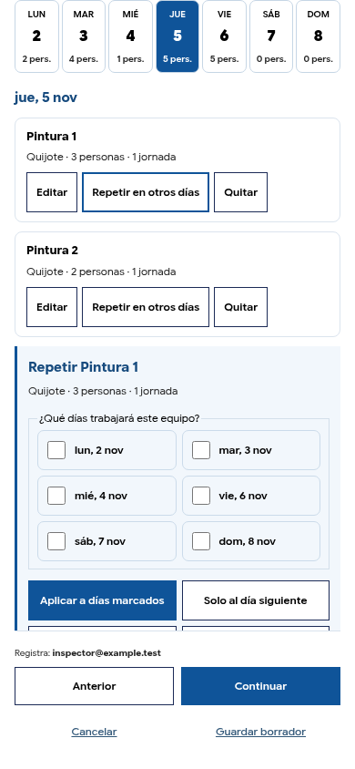

# Last Planner — formulario simplificado y repetición por equipo

## Correcciones

Se retiraron del formulario visible los bloques solicitados: «Ver cálculo y antecedentes», «Opciones avanzadas de rendimiento», «Ubicación adicional» (sector/frente) y «Partida y superficie de referencia». La cantidad, la unidad, el rendimiento sencillo y la capacidad estimada siguen disponibles.

Los valores históricos de los campos retirados se conservan internamente al editar. Se mantienen los modelos persona/cuadrilla y sus unidades; no se convierten entre sí ni se borran sus antecedentes. En nuevas actividades se reutiliza el nombre ya registrado como identificación exacta del trabajo, sin pedirlo nuevamente ni inferir una categoría constructiva desde palabras sueltas. Las advertencias sobre fechas incompatibles o posibles coincidencias de equipo solo aparecen cuando corresponden.

## Orden de programación

1. Seleccionar un día y agregar el equipo, empresa y dotación.
2. Aplicar el equipo para incorporarlo a la programación.
3. Desde ese equipo guardado, pulsar «Repetir en otros días».
4. Revisar el equipo y dotación que se copiarán, marcar los días y aplicar.

Un día vacío solo ofrece «Agregar equipo». Los controles de repetición no aparecen antes de registrar uno. El editor de repetición muestra una sola empresa/equipo y copia únicamente esa asignación, conservando los demás equipos del destino. Repetir sobre el mismo equipo/fecha pide confirmación para actualizarlo; no crea duplicados.

«Seleccionar toda la semana» marca los días disponibles, pero no guarda nada hasta pulsar «Aplicar a días marcados». Sin destinos elegidos se muestra un mensaje y no se altera la programación. Se puede copiar al día siguiente o cancelar. Los días quedan limitados al período planificado y tienen etiquetas legibles.

## Integración y comprobaciones

No hay cambios de tablas ni migraciones. Se conserva la persistencia de actividades, la programación por fechas, el visor y el flujo de Nube.

Archivos: `dist/lastplanner-daily-ui.mjs`, `dist/lastplanner-resources.mjs`, `dist/lastplanner-wizard.mjs`, estilos en `dist/lastplanner-cycle.css`, pruebas contextual/de ejes y manifiesto `dist/sw.js` regenerado.

Validación:

- Cadena de Render: 38 comprobaciones aprobadas.
- Asistente en 320, 375, 390, 430, 768 y 1280 px: ausencia de los bloques retirados, repetición solo después de registrar un equipo, copia individual, cantidades, guardado, recuperación y sincronización.
- Repetición sin días, cancelación de una actualización existente, confirmación sin duplicados, selección de toda la semana sin guardado automático y conservación de otros equipos.
- Cambio de unidad en una actividad recuperada: no se reutiliza una tasa incompatible; al ingresar nuevamente el rendimiento, la referencia utiliza la unidad elegida y conserva las asignaciones.
- Ciclo completo de publicación, asistencia, ejecución, verificación, saldo, respaldo y conflictos de sincronización aprobado.
- Prueba de ejes, guardado y recuperación de valores históricos de frente de trabajo, aunque ya no se muestran como campos editables.

QA móvil con Chromium táctil; no se ha comprobado en un iPhone físico.

## Captura real del editor de repetición

## Activación

Fusionar esta PR y desplegar el último commit en Render. No requiere SQL adicional. No se ha desplegado en producción desde el entorno de desarrollo.
