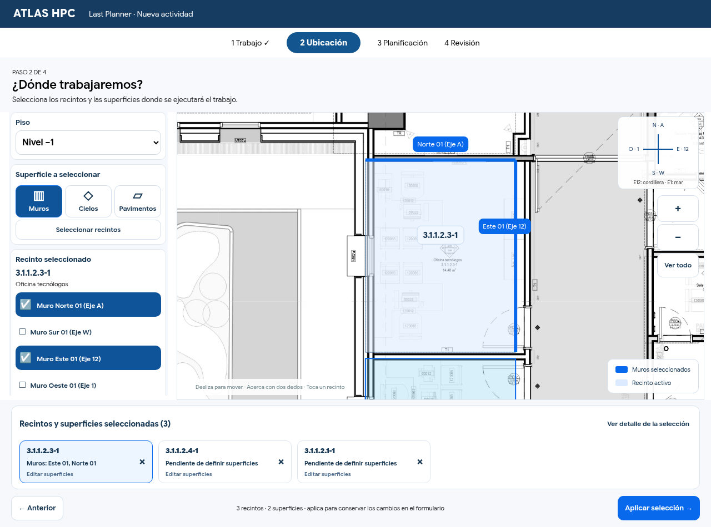
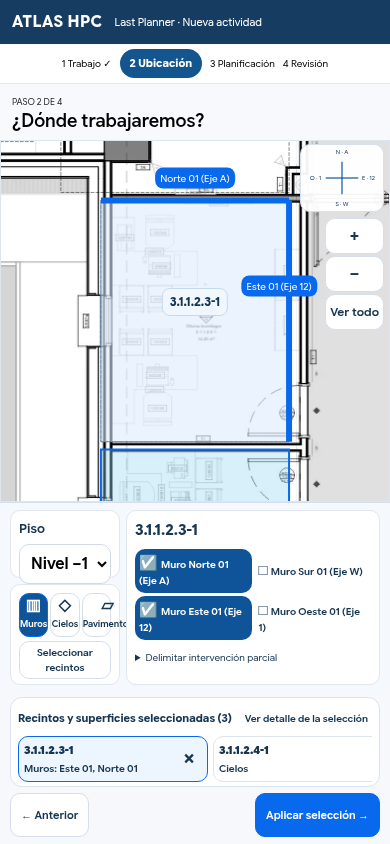

# Selección visual de superficies — referencia de interfaz

La selección de Last Planner utiliza ahora un espacio de trabajo basado en la referencia del usuario. Sigue usando el visor principal de arquitectura, sus geometrías, navegación táctil y transformación de coordenadas.

## Interfaz implementada

- Cabecera institucional y contexto del paso 2 de los cuatro pasos existentes, sin mensajes ficticios de guardado.
- En escritorio: panel izquierdo con piso, Muros/Cielos/Pavimentos y un único recinto activo; plano amplio en el centro; brújula y navegación a la derecha; tarjetas de selección abajo.
- En móvil: el plano queda encima del editor compacto. Las cuatro orientaciones se muestran en dos columnas, y las tarjetas inferiores admiten desplazamiento propio. El ancho de la página no desborda.
- Muros ordenados Norte, Sur, Este y Oeste; los tramos adicionales conservan sus identificadores geométricos y etiquetas reales. Las casillas comunican su estado a tecnologías de asistencia.
- Resaltado azul sobre los tramos seleccionados; relleno suave que identifica el recinto activo. Código del recinto y etiquetas de orientación/eje sobre el plano cuando son visibles.
- Una tarjeta por recinto con resumen de las superficies. Tocar «Editar superficies» enfoca ese recinto en el mismo visor y recupera sus marcas. Quitar un recinto es una acción independiente. «Ver detalle» permite quitar una superficie concreta.
- Selección completa de la proyección de cielos/pavimentos mediante acción explícita; trazados parciales disponibles en un desplegable. Se conserva la advertencia de que un contorno no verifica un muro físico ni la disponibilidad constructiva.
- «Aplicar selección» devuelve los datos al asistente real. «Anterior» descarta la edición del visor y vuelve al formulario. El guardado definitivo y la sincronización siguen siendo los existentes.

Las referencias cardinales siguen siendo N→A, S→W, E→12 y O→1, calibradas desde los ejes por piso. No se asumieron alturas, terminaciones ni cantidades. Esta entrega no modifica tablas, permisos ni servicios de persistencia.

## Archivos

- `dist/lastplanner-spatial.mjs`: composición, edición por tarjeta, selección accesible, etiquetas geométricas y código activo.
- `dist/lastplanner-cycle.css`: distribución adaptable y estilos limitados a la selección espacial.
- `lastplanner-contextual-browser-test.mjs`: prueba de tarjetas, selección, regiones sin superposición y capturas en seis anchos.
- `lastplanner-browser-test.mjs`, `lastplanner-axes-browser-test.mjs`: adaptación de las comprobaciones al nuevo contador y al desplegable de trazados.
- `dist/sw.js`: manifiesto de funcionamiento sin conexión regenerado.

## Verificación

- Cadena de Render: 38 comprobaciones aprobadas.
- Prueba contextual completa en 320, 375, 390, 430, 768 y 1280 px: recintos reales, Norte/Este, resaltado, edición desde tarjetas, retorno al formulario, guardado, recuperación y sincronización entre navegadores.
- Se comprueba que el plano tenga espacio utilizable, que no quede debajo del panel ni del resumen, y que la página no tenga desbordamiento horizontal.
- Ciclo completo: selección, publicación, restricción previa, bloqueo, asistencia, ejecución parcial delimitada, verificación, saldo, sincronización, recuperación sin red e históricos.
- Prueba de ejes desde la selección y su persistencia, y orientación geométrica de cuatro pisos.
- Capturas reales del navegador disponibles abajo. Las pruebas usan Chromium con interacción táctil; no sustituyen una comprobación en Safari de un iPhone físico.

## Capturas de la implementación

### Escritorio

### Móvil

## Activación

Fusionar esta PR y publicar el último commit en Render. Esta entrega no necesita SQL adicional. No se ha desplegado en producción desde el entorno de desarrollo.
